<div align="center">


</div>

<p align="center">
  
  
  
  
  
</p>

# Cat vs Dog Fight - Turn-based throwing duel built on AK Embedded Base Kit

<p align="center">
  <a href="resources/images/cat_dog_fight_banner_2x1.png">
    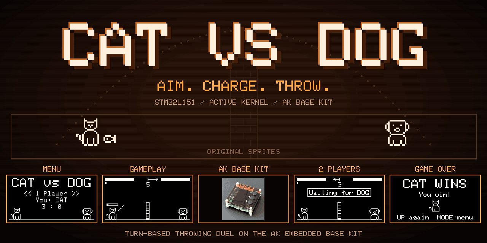
  </a>
</p>

---

## Demo

<p align="center">
  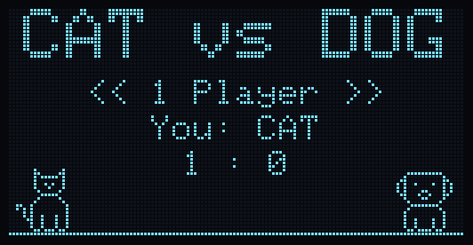
</p>

## Documentation

| File | Description |
| --- | --- |
| [README.md](README.md) | Project overview, hardware, game objects, controls, and the basic match flow. |
| [docs/01-guide-coding-rules.md](docs/01-guide-coding-rules.md) | Naming conventions, code style and clang-format setup, commit messages, and document naming. |
| [docs/02-design-sequence-object.md](docs/02-design-sequence-object.md) | Owned state and signal sequences of Match, Cat, Dog, Border, Wind, Power, Missile, Link, and CPU. |
| [docs/03-design-sequence-runtime.md](docs/03-design-sequence-runtime.md) | Match start, playing and reset flows (with the RF24 link), task ownership, button processing, and scheduling notes. |

## Introduction

Cat vs Dog Fight is a turn-based throwing game built on the AK Embedded Base Kit. A cat and a dog stand on each side of a brick wall and take turns throwing fish and bones at each other. The player picks an angle, holds a button to charge the power bar, and releases it to throw. The wind changes every turn and pushes the throw left or right. Each hit costs 20 HP, and the first player to reach 0 HP loses.

The game can be played in two ways:

- **1 Player:** against the computer on a single kit, at an Easy or Hard level.
- **2 Players:** two kits, one playing the cat and one the dog, talking over an **nRF24L01** radio.

Through this project, I practiced several embedded concepts:

- **System design:** Splitting the game into objects with clear responsibilities (match, players, wall, wind, power, missile, radio link, computer player).
- **Task management:** Running each object as an AK task, cooperatively and without blocking delays.
- **Communication:** Using signals, timers, and messages between tasks, and the same messages over RF24 between two boards.
- **Deterministic simulation:** Integer fixed-point physics so both boards compute the same flight, and the computer player predicts throws with the game's own flight code.

### I. Hardware

<table align="center">
  <tr>
    <td align="center"></td>
  </tr>
</table>
<p align="center"><strong><em>Figure 1:</em></strong> AK Embedded Base Kit - STM32L151</p>

[AK Embedded Base Kit](https://epcb.vn/products/ak-embedded-base-kit-lap-trinh-nhung-vi-dieu-khien-mcu) is a development kit for people who already have some experience with embedded programming and want to learn more through practice.

The board includes an **OLED display**, **3 push buttons**, and **a buzzer** that can play simple sounds or short melodies. With these built-in parts, you can create small games, menu systems, clocks, and other interactive projects. It is also a good way to learn how **event-driven programming** works in a real embedded system.

**Kit versions:** the **2 Players** mode needs a kit with the **nRF24L01** header (version 2: 1.3-inch OLED, driver SH1106). The version 3 kit (1.54-inch OLED, driver SSD1309) has no nRF24 header, so it can only play **1 Player**. The OLED driver is selected in `HARDWARE_OPTION` of `application/Makefile`.

**MCU Overview:**

```text
SoC Name : STM32L151CBT6
RAM      : 16 KB

Flash Partitions Layout
----------------------
[ 0x08000000 - 0x08001FFF ] : Bootloader Partition (8 KB)
=> AK Bootloader

[ 0x08002000 - 0x08002FFF ] : BSF Shared Partition (4 KB)
=> Used for data sharing between Bootloader and Application

[ 0x08003000 - 0x0801FFFF ] : Application Partition (116 KB)
=> Cat vs Dog Fight firmware
```

**MCU Naming Convention:**

| Part | Meaning |
|---|---|
| `STM32` | STMicroelectronics 32-bit MCU family. |
| `L` | Low-power series. |
| `151` | STM32L151 product line. |
| `C` | 48-pin package. |
| `B` | 128 KB Flash memory. |
| `T` | LQFP package. |
| `6` | Industrial temperature grade. |

<table align="center">
  <tr>
    <td align="center"></td>
  </tr>
</table>
<p align="center"><strong><em>Figure 2:</em></strong> Board view Top + Bottom </p>

**nRF24L01 radio:** SPI1 (`PA5` SCK, `PA6` MISO, `PA7` MOSI), CE `PA8`, CSN `PB9`, IRQ `PB1`. Channel 120, 2 Mbps. Each board gets its RF24 address at build time:

```bash
make -C application BOARD=cat flash dev=/dev/ttyUSB0   # cat board, RF24 address 1
make -C application BOARD=dog flash dev=/dev/ttyUSB0   # dog board, RF24 address 2
```

### II. Game Description and Objects

This section describes the screens and objects of **Cat vs Dog Fight**.

<table align="center">
  <tr>
    <td align="center">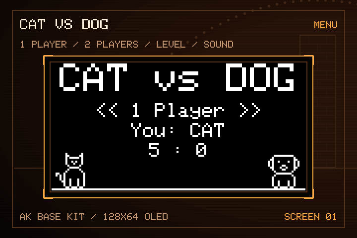</td>
  </tr>
</table>
<p align="center"><strong><em>Figure 3:</em></strong> Menu screen</p>

After the boot logo, the game opens on the **Menu**:

- **1 Player:** Play against the computer on this kit.
- **2 Players:** Wait for the other kit over RF24, then play.
- **Level:** Computer level, **EASY** or **HARD**.
- **Sound:** Mute or unmute every sound, including the boot melody.
- **Exit:** Back to the boot logo.

The menu also shows the role of this board (**You: CAT** or **You: DOG**) and the saved score (cat wins : dog wins).

<table align="center">
  <tr>
    <td align="center">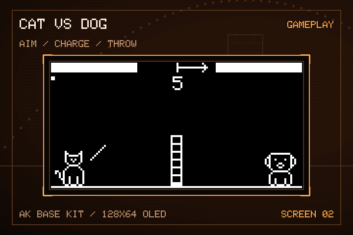</td>
  </tr>
</table>
<p align="center"><strong><em>Figure 4:</em></strong> Playing screen</p>

The playing screen shows:

- **HP bars** in the top corners, with a dot under the bar of the player whose turn it is.
- **Wind** in the top middle: an arrow pointing where the wind blows and its strength (0 to 5).
- **Power bar** over the head of the thrower, and an **aim line** from its hand.
- **The wall** in the middle. A low throw hits it and raises dust.

<table align="center">
  <tr>
    <td align="center">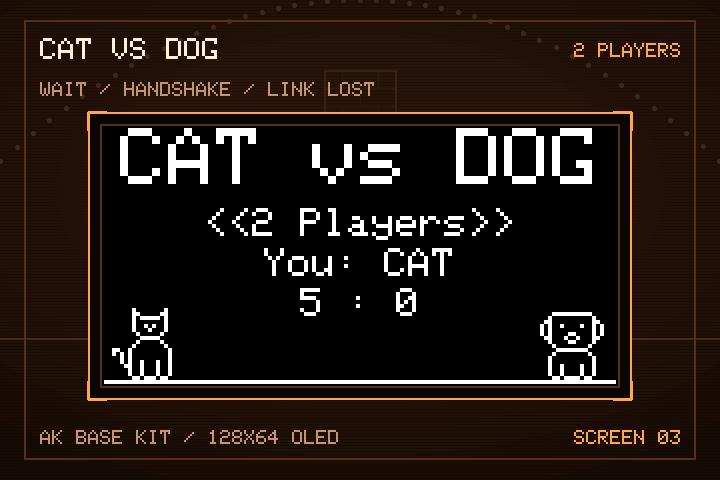</td>
  </tr>
</table>
<p align="center"><strong><em>Figure 5:</em></strong> 2 Players: waiting, handshake and LINK LOST</p>

#### Objects in the Game:

<div align="center">
<table>
  <thead>
    <tr>
      <th align="center">Bitmap</th>
      <th align="center">Object Name</th>
      <th align="center">Description</th>
    </tr>
  </thead>
  <tbody>
    <tr>
      <td align="center" valign="middle">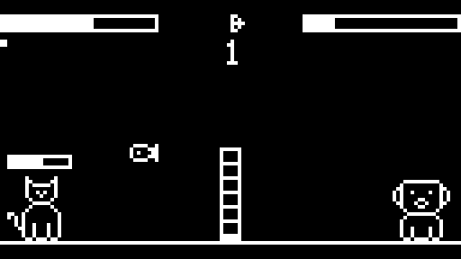</td>
      <td align="center"><strong>Match</strong></td>
      <td>Game mode, match state, whose turn it is and the winner. Ends each turn, and keeps the mute setting, the computer level and the wins in EEPROM.</td>
    </tr>
    <tr>
      <td align="center" valign="middle">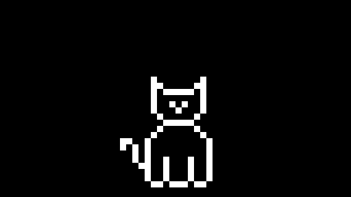</td>
      <td align="center"><strong>Cat</strong></td>
      <td>Left player. Throws fish. Holds its HP, throw angle and hit effect.</td>
    </tr>
    <tr>
      <td align="center" valign="middle">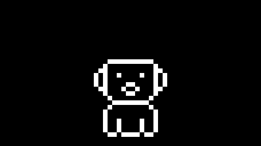</td>
      <td align="center"><strong>Dog</strong></td>
      <td>Right player. Throws bones. Holds its HP, throw angle and hit effect.</td>
    </tr>
    <tr>
      <td align="center" valign="middle">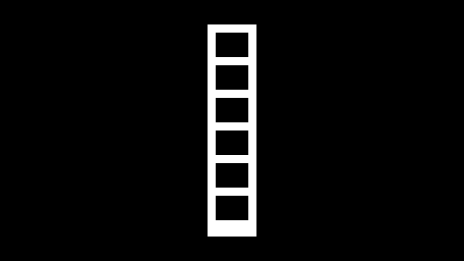</td>
      <td align="center"><strong>Border</strong></td>
      <td>Brick wall in the middle of the field. Stops low throws and shows dust where it was hit.</td>
    </tr>
    <tr>
      <td align="center" valign="middle">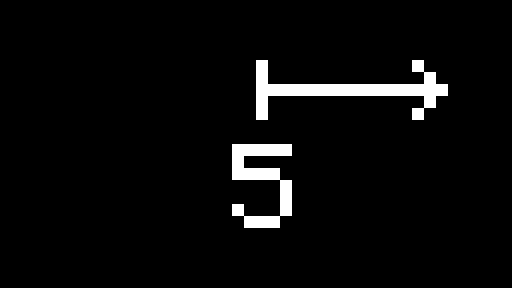</td>
      <td align="center"><strong>Wind</strong></td>
      <td>Wind from -5 to +5, picked again every turn. Pushes the flight left or right.</td>
    </tr>
    <tr>
      <td align="center" valign="middle">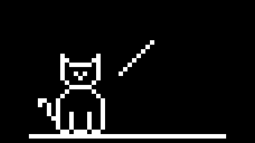</td>
      <td align="center"><strong>Power</strong></td>
      <td>Power bar. Sweeps 0 to 100 and back while [Mode] is held, and locks when it is released.</td>
    </tr>
    <tr>
      <td align="center" valign="middle">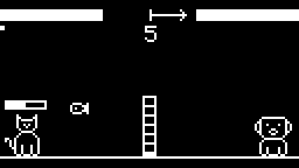</td>
      <td align="center"><strong>Missile</strong></td>
      <td>The fish or bone in flight. Integer physics with gravity and wind, and collision with the wall, the other player and the ground.</td>
    </tr>
    <tr>
      <td align="center" valign="middle">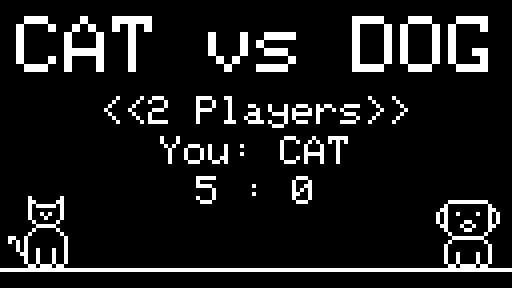</td>
      <td align="center"><strong>Link</strong></td>
      <td>RF24 link to the other kit: handshake, throws, results, heartbeat and loss detection.</td>
    </tr>
    <tr>
      <td align="center" valign="middle">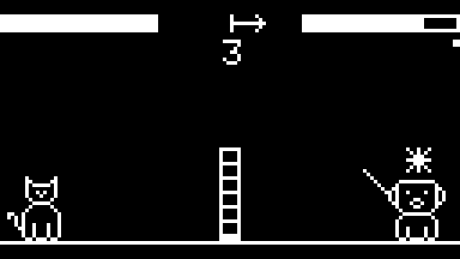</td>
      <td align="center"><strong>CPU</strong></td>
      <td>Computer player for 1 Player. Simulates throws with the game's own flight and misses on purpose by its level.</td>
    </tr>
  </tbody>
</table>
</div>

> **Note:** For detailed object flows, see [Game Object Sequences](docs/02-design-sequence-object.md).

### III. How to Play

The kit has three buttons: **[Mode]**, **[Up]**, and **[Down]**.

- **Menu:** **[Up]** / **[Down]** choose an item, **[Mode]** selects it.
- **Your turn:** **[Up]** / **[Down]** raise or lower the throw angle (15° to 75°, 5° per press). **Hold [Mode]** to charge the power bar and **release** to throw.
- **Other player's turn:** the buttons do nothing. In 1 Player the computer aims for a moment, then throws.
- **Waiting for the other kit:** **[Mode]** gives up and goes back to the menu.
- **Leave a match:** press **[Up]** while holding **[Down]** (or the other way round) at any time. In 2 Players the other kit shows **LINK LOST** after 6 seconds.
- **Game over:** **[Up]** plays again, **[Mode]** goes back to the menu.

#### Game Mechanics:

- **Turns:** The cat always throws first. A throw ends when the missile hits the other player, the wall, or the ground, or leaves the screen.
- **Damage:** Each hit costs **20 HP**. Both players start with **100 HP**.
- **Wind:** A new wind is picked at the start of every turn. A strong headwind needs more power, a tailwind needs less.
- **The wall:** Throws below about 45° usually hit the wall.
- **Computer level:** The computer finds the angle with the widest hitting power range for the current wind, then adds a random power error: **±30 on Easy** (hits about 2 throws in 5), **±16 on Hard** (hits about 7 in 10).
- **2 Players:** The thrower's board decides how the throw ended and sends the result. If no message arrives from the other kit for 6 seconds, the screen shows **LINK LOST** and goes back to the menu.
- **Persistence:** The mute setting, the computer level, and the wins are stored in EEPROM with a magic number and a checksum.

<table align="center">
  <tr>
    <td align="center">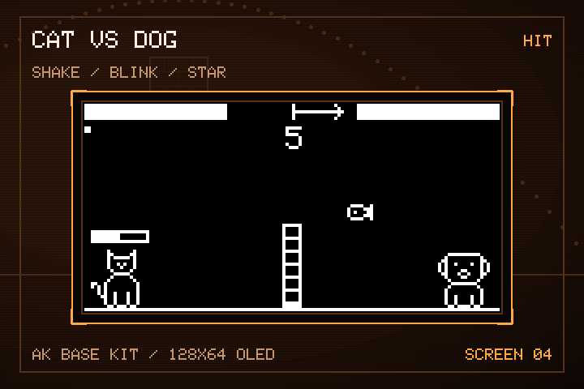</td>
  </tr>
</table>
<p align="center"><strong><em>Figure 6:</em></strong> Hit effect</p>

<table align="center">
  <tr>
    <td align="center">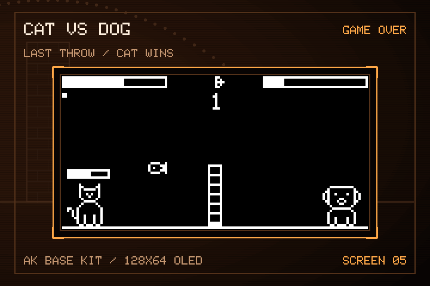</td>
  </tr>
</table>
<p align="center"><strong><em>Figure 7:</em></strong> Game over screen</p>

### IV. Basic Game Sequence Logic

> **Note:** For the complete signal flow, see [Runtime Signal Processing](docs/03-design-sequence-runtime.md).

<table align="center">
  <tr>
    <td align="center">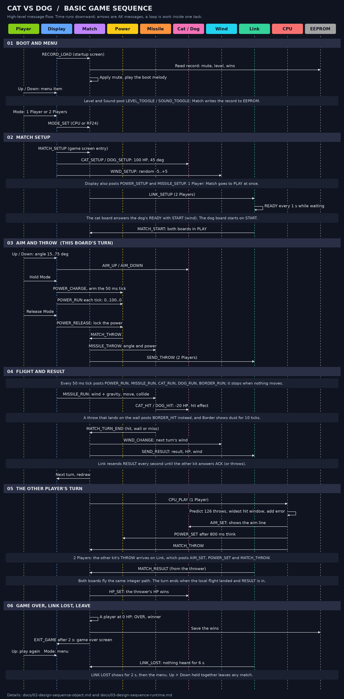</td>
  </tr>
</table>
<p align="center"><strong><em>Figure 8:</em></strong> Game sequence logic</p>

## Contact & Support

<p style="font-size: 20px;"><strong>Cao Trong Phuoc</strong> - Software Engineer - Embedded Systems</p>

```text
Thank you for visiting this repository.
If you have any questions, suggestions, or feedback about this project or firmware development, feel free to contact me directly.
```

<a href="https://github.com/caotrongphuoc">
  
</a>

<a href="https://www.linkedin.com/in/cao-trong-phuoc/">
  
</a>
