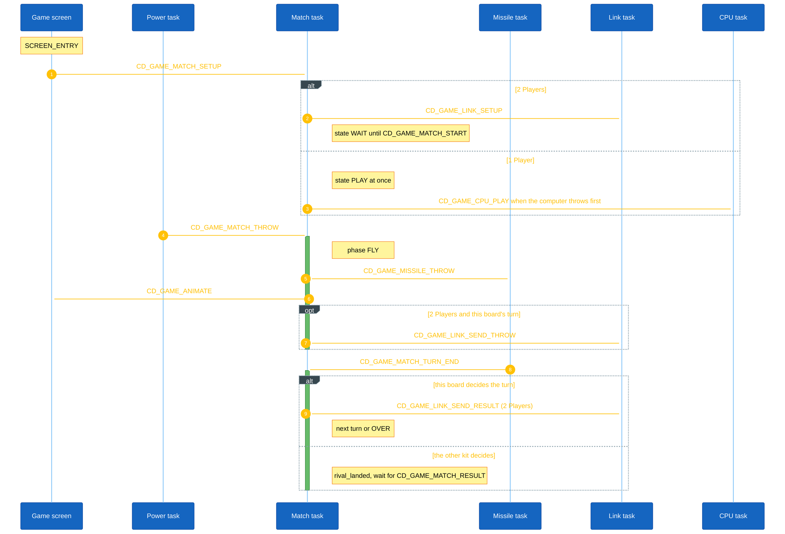
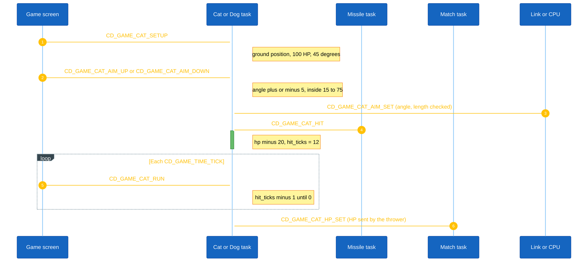
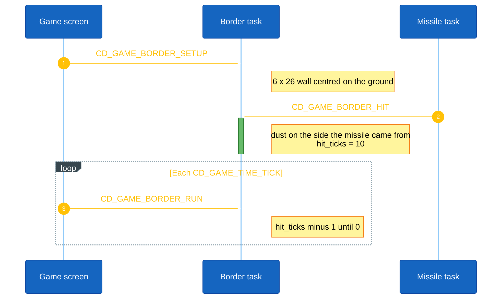
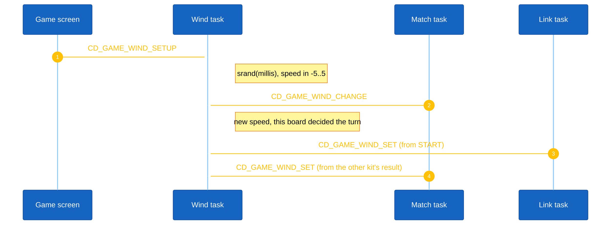
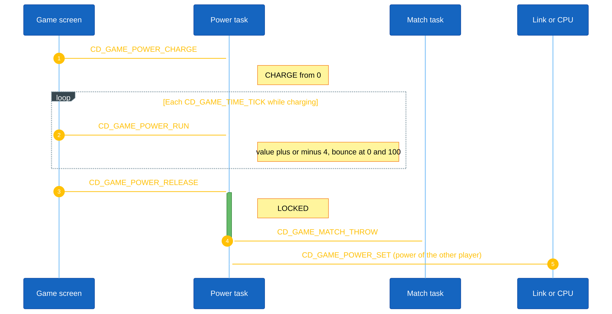
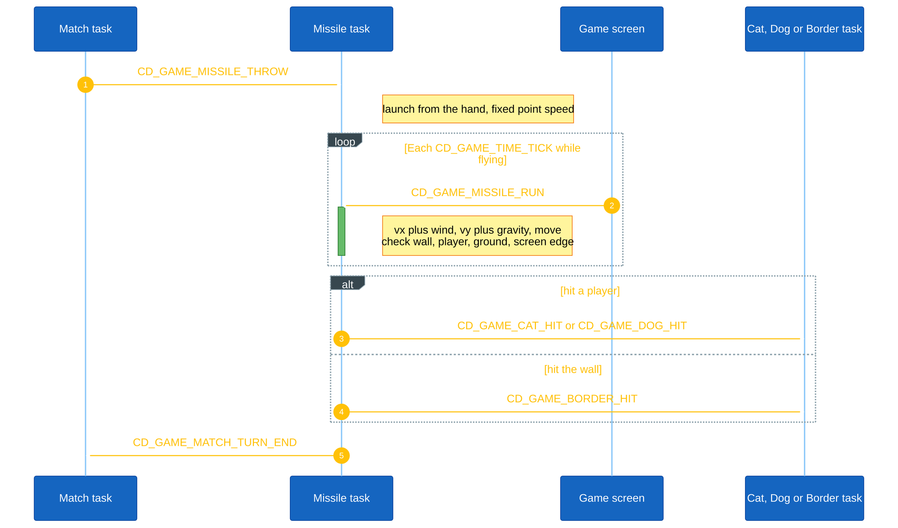
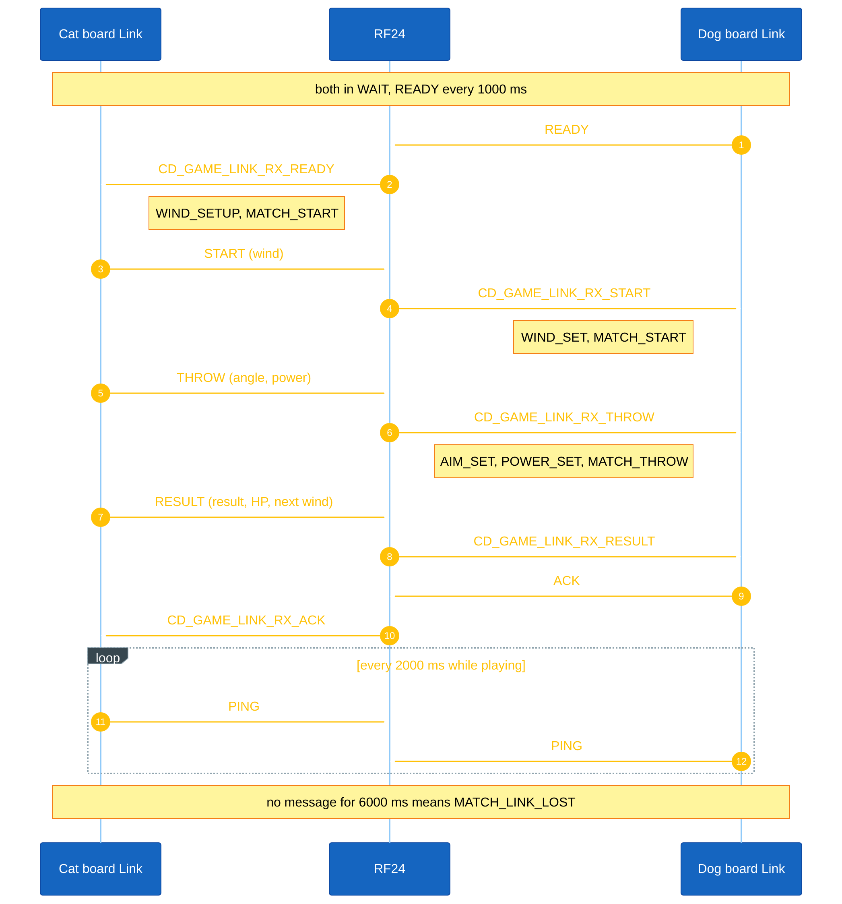
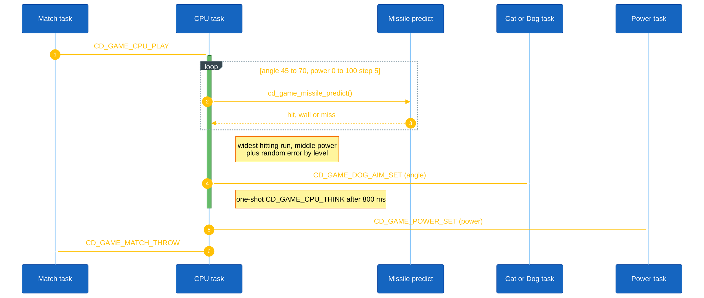

<h1 align="center">Game Object Sequences</h1>

This document describes the runtime sequence of each object in Cat vs Dog Fight. Each object is handled by its own AK task (all at `TASK_PRI_LEVEL_4`) and receives signals from the game screen on the display task, the 50 ms game tick, the other objects, the RF24 link, or the computer player.

## I. Object Summary

| Object | Task ID | Handler | Main responsibility |
|---|---|---|---|
| Match | `CD_GAME_MATCH_ID` | `cd_game_match_handle()` | Game mode, match state, turn, phase and winner. Ends each turn, starts the next one, and owns the EEPROM record (mute, level, wins). |
| Cat | `CD_GAME_CAT_ID` | `cd_game_cat_handle()` | Left player: position, HP, throw angle and hit effect. |
| Dog | `CD_GAME_DOG_ID` | `cd_game_dog_handle()` | Right player: position, HP, throw angle and hit effect. |
| Border | `CD_GAME_BORDER_ID` | `cd_game_border_handle()` | Brick wall in the middle and the dust where it was hit. |
| Wind | `CD_GAME_WIND_ID` | `cd_game_wind_handle()` | Wind speed from `-WIND_SPEED_MAX` to `WIND_SPEED_MAX`. |
| Power | `CD_GAME_POWER_ID` | `cd_game_power_handle()` | Power bar: idle, charging while [Mode] is held, locked on release. |
| Missile | `CD_GAME_MISSILE_ID` | `cd_game_missile_handle()` | Fish or bone in flight, fixed-point physics and collisions. Also predicts a throw for the computer. |
| Link | `CD_GAME_LINK_ID` | `cd_game_link_handle()` | RF24 messages to and from the other kit, heartbeat and loss detection (2 Players). |
| CPU | `CD_GAME_CPU_ID` | `cd_game_cpu_handle()` | Computer player (1 Player): plans a throw and plays it after `CD_GAME_CPU_THINK_INTERVAL`. |

Only the handler of an object writes its state. The game screen, the shell (`stt`, `lnk`) and the other objects read it, and change it by posting a signal. All game tasks share one priority, so the AK kernel runs their messages in the order they were posted.

## II. Match Object Sequence

Match owns `mode` (`MATCH_MODE_CPU` or `MATCH_MODE_RF`), `state` (`OFF`, `WAIT`, `PLAY`, `OVER`, `LOST`), `turn` (cat or dog), `phase` (`AIM` or `FLY`), `winner`, the rival-turn flags (`rival_landed`, `rival_result` and the received HP and wind) and the EEPROM `record`.

**Setup.** The startup screen posts `CD_GAME_MATCH_RECORD_LOAD` once at boot: the record is read, the mute setting applied and the boot melody played. The menu posts `CD_GAME_MATCH_MODE_SET` (1-byte payload, length checked) before it opens the game screen, and the game screen posts `CD_GAME_MATCH_SETUP` on `SCREEN_ENTRY`. In 2 Players, `SETUP` sets `WAIT` and posts `CD_GAME_LINK_SETUP`. Against the computer the match goes straight to `PLAY`, and the computer is told to play when it holds the first turn.

**Input.** `CD_GAME_MATCH_SOUND_TOGGLE` and `CD_GAME_MATCH_LEVEL_TOGGLE` from the menu (each writes the record), `CD_GAME_MATCH_START` from Link, `CD_GAME_MATCH_THROW` from Power, Link or CPU, `CD_GAME_MATCH_RESULT` (payload `cd_game_link_result_t`, length checked) and `CD_GAME_MATCH_LINK_LOST` from Link.

**Cross-task.** `THROW` in `PLAY` and `AIM` sets `FLY`, plays the click, posts `CD_GAME_MISSILE_THROW`, posts `CD_GAME_ANIMATE` to the display, and in 2 Players on this board's turn posts `CD_GAME_LINK_SEND_THROW`. `TURN_END` from Missile ends a turn this board decides (every turn against the computer, its own turns over RF24): it posts `CD_GAME_WIND_CHANGE` while both players have HP, `CD_GAME_LINK_SEND_RESULT` in 2 Players, and goes to the next turn. On a turn the other kit decides, the turn ends only when the local flight has landed **and** the result has arrived (or at once if the result arrives while still aiming, when the `THROW` was lost). The result's HP and wind are posted with `CD_GAME_CAT_HP_SET`, `CD_GAME_DOG_HP_SET` and `CD_GAME_WIND_SET`.

**Next turn.** A player at 0 HP ends the match: `OVER`, the winner, its win count saved, the win or lose melody, and a one-shot `CD_GAME_EXIT_GAME` on the display after `CD_GAME_TIME_EXIT_INTERVAL` (2000 ms). Otherwise the turn switches, `AIM` is set, Power is reset, the screen is redrawn, and `CD_GAME_CPU_PLAY` is posted when the computer plays next.

**Reset.** `CD_GAME_MATCH_RESET` (posted by the screen on exit) sets `OFF`. `LINK_LOST` in `PLAY` sets `LOST` and arms the same exit timer.

<strong><em>Figure 1:</em></strong> Match sequence logic

## III. Cat and Dog Object Sequence

Cat and Dog are two tasks with the same behaviour. Each owns `x`, `y`, `hp`, `angle` and `hit_ticks`.

**Setup.** `CD_GAME_CAT_SETUP` / `CD_GAME_DOG_SETUP` on `SCREEN_ENTRY` place the player on the ground, set `CAT_HP_MAX` (100) HP, `CD_GAME_ANGLE_DEFAULT` (45°) and no hit effect.

**Input.** `*_AIM_UP` / `*_AIM_DOWN` from the game screen on this board's turn change the angle by `CD_GAME_ANGLE_STEP` (5°) inside 15° to 75°. `*_AIM_SET` (1-byte payload from Link or CPU) sets the angle of the other player; an angle out of range or off the 5° grid is ignored.

**Per-tick.** `*_RUN` counts `hit_ticks` down to 0.

**Cross-task.** `*_HIT` from Missile removes `CD_GAME_HIT_DAMAGE` (20) HP, never below 0, and starts the hit effect (`CAT_HIT_TICKS`, 12 ticks: shake, blink and a star). `*_HP_SET` from Match writes the HP sent by the other kit, which wins over the local flight.

<strong><em>Figure 2:</em></strong> Cat and Dog sequence logic (Dog uses the CD_GAME_DOG_* signals)

## IV. Border Object Sequence

Border owns the wall rectangle (`x`, `y`, `width`, `height`) and the dust (`hit_x`, `hit_y`, `hit_ticks`).

**Setup.** `CD_GAME_BORDER_SETUP` centres a `BORDER_WIDTH` x `BORDER_HEIGHT` (6 x 26) wall on the ground.

**Cross-task.** `CD_GAME_BORDER_HIT` from Missile reads where the missile stopped and puts the dust on the side it came from (left for the fish, right for the bone), on top of the wall when it hit from above, for `BORDER_HIT_TICKS` (10) ticks.

**Per-tick.** `CD_GAME_BORDER_RUN` counts `hit_ticks` down. The screen draws two dust frames in turn while it runs.

<strong><em>Figure 3:</em></strong> Border sequence logic

## V. Wind Object Sequence

Wind owns `speed`, from `-WIND_SPEED_MAX` to `WIND_SPEED_MAX` (-5 to +5). A negative speed blows toward the cat.

**Setup.** `CD_GAME_WIND_SETUP` seeds `rand()` with `sys_ctrl_millis()` and picks a speed. The game screen posts it on `SCREEN_ENTRY`, and the cat board posts it again when it opens a 2 Players match, just before it sends `START`.

**Cross-task.** `CD_GAME_WIND_CHANGE` from Match picks a new speed when a turn this board decides ends. `CD_GAME_WIND_SET` (1-byte payload, out of range ignored) writes the speed chosen by the other kit, from `START` or from a result.

<strong><em>Figure 4:</em></strong> Wind sequence logic

## VI. Power Object Sequence

Power owns `state` (`IDLE`, `CHARGE`, `LOCKED`), `value` (0 to `POWER_VALUE_MAX`) and the sweep direction.

**Setup.** `CD_GAME_POWER_SETUP` on `SCREEN_ENTRY` and at the start of each turn sets `IDLE` and 0.

**Input.** `CD_GAME_POWER_CHARGE` (the screen, [Mode] pressed on this board's turn while aiming) starts the sweep from 0. `CD_GAME_POWER_RELEASE` ([Mode] released) locks the value and posts `CD_GAME_MATCH_THROW`; it is ignored when not charging. `CD_GAME_POWER_SET` (1-byte payload from Link or CPU) locks the power of the other player.

**Per-tick.** `CD_GAME_POWER_RUN` while charging adds or removes `POWER_STEP` (4), turning around at 0 and 100, so one sweep up and down takes about 2.5 s.

<strong><em>Figure 5:</em></strong> Power sequence logic

## VII. Missile Object Sequence

Missile owns `type` (fish or bone), `state` (`IDLE` or `FLY`), `result` and the position and speed `x`, `y`, `vx`, `vy` in 1/256 pixel (`MISSILE_FIXED_SHIFT`). Integer maths only, so both kits and the computer compute the same flight.

**Setup.** `CD_GAME_MISSILE_SETUP` sets `IDLE`.

**Cross-task.** `CD_GAME_MISSILE_THROW` from Match launches from the thrower's hand with its angle and the locked power: speed from `MISSILE_SPEED_MIN` (2.0 px/tick) to `MISSILE_SPEED_MAX` (6.5 px/tick), split by a cosine table.

**Per-tick.** `CD_GAME_MISSILE_RUN` while flying adds `wind.speed * MISSILE_WIND_FORCE` to `vx` and `MISSILE_GRAVITY` (0.25 px/tick²) to `vy`, moves, then checks in this order: the wall, the other player, the ground, leaving the screen. When the flight ends it plays a sound, posts `CD_GAME_CAT_HIT`, `CD_GAME_DOG_HIT` or `CD_GAME_BORDER_HIT`, then `CD_GAME_MATCH_TURN_END`.

**Prediction.** `cd_game_missile_predict()` runs the same launch and steps on a local copy for up to `MISSILE_PREDICT_TICKS_MAX` (200) ticks and returns how it would end. CPU uses it to plan.

<strong><em>Figure 6:</em></strong> Missile sequence logic

## VIII. Link Object Sequence

Link owns the message counters, the time of the last message from the other kit, the tick count, `rival_playing`, and the pending `RESULT` and its copy.

Every message is sent through `task_if` with `if_des_type = IF_TYPE_RF24_RIVAL`, `if_des_task_id = CD_GAME_LINK_ID` and `if_sig = CD_GAME_LINK_RX_*`, and arrives on the other kit as that signal on Link. `READY`, `PING` and `ACK` are pure messages. `START`, `THROW` and `RESULT` are common messages with a `packed` payload whose length is checked on arrival.

**Setup.** `CD_GAME_LINK_SETUP` (from Match in 2 Players) clears the counters, sends `READY` and arms a periodic `CD_GAME_LINK_TICK` every `CD_GAME_LINK_TICK_INTERVAL` (1000 ms).

**Per-tick.** `CD_GAME_LINK_TICK`: in `WAIT`, send `READY`. Otherwise, resend `RESULT` while it is not acked, and in `PLAY` send `PING` every `LINK_PING_TICKS` (2) ticks and post `CD_GAME_MATCH_LINK_LOST` when nothing arrived for `LINK_LOST_TIMEOUT` (6000 ms).

**Input.** `CD_GAME_LINK_SEND_START` / `SEND_THROW` / `SEND_RESULT` from this board. From the other kit:

- `RX_READY`: the cat board opens the match (`CD_GAME_WIND_SETUP`, `SEND_START`, `CD_GAME_MATCH_START`), or sends `START` again when the dog missed it. A `READY` in `PLAY` from a kit that was already playing means it left and came back: `LINK_LOST`.
- `RX_START` (dog board, in `WAIT`): `CD_GAME_WIND_SET`, then `CD_GAME_MATCH_START`.
- `RX_THROW` (the other player's turn, while aiming): `*_AIM_SET`, `CD_GAME_POWER_SET`, `CD_GAME_MATCH_THROW`. It also clears a pending `RESULT`, because the other kit only throws after it applied it.
- `RX_RESULT`: always answered with `ACK`, then forwarded as `CD_GAME_MATCH_RESULT` on the other player's turn.
- `RX_PING` and `RX_ACK`: keep the link alive, `ACK` clears the pending `RESULT`.

**Reset.** `CD_GAME_LINK_RESET` (screen exit) removes the tick and the pending `RESULT`.

<strong><em>Figure 7:</em></strong> Link sequence logic

## IX. CPU Object Sequence

CPU owns the planned `angle` and `power` and the hitting power window (`hit_from`, `hit_to`) at that angle, shown by `stt`.

**Cross-task.** `CD_GAME_CPU_PLAY` from Match, when the computer holds the turn: CPU calls `cd_game_missile_predict()` for every angle from `CPU_ANGLE_MIN` (45°) to `CPU_ANGLE_MAX` (70°) and every power in `CPU_POWER_STEP` (5) steps with the current wind, keeps the angle with the widest run of hits, aims at the middle of that run and adds a random error of `CPU_POWER_ERROR_EASY` (±30) or `CPU_POWER_ERROR_HARD` (±16). It posts `*_AIM_SET` so the aim line shows, and arms a one-shot `CD_GAME_CPU_THINK` after `CD_GAME_CPU_THINK_INTERVAL` (800 ms).

**Timer.** `CD_GAME_CPU_THINK` checks it is still the computer's turn, then posts `CD_GAME_POWER_SET` and `CD_GAME_MATCH_THROW`.

**Reset.** `CD_GAME_CPU_RESET` (screen exit) removes the think timer.

<strong><em>Figure 8:</em></strong> CPU sequence logic

## X. Per-Tick Signal Order

The game screen arms the periodic `CD_GAME_TIME_TICK` (`CD_GAME_TIME_TICK_INTERVAL`, 50 ms) on the display task only while something moves: when [Mode] is pressed to charge, and on `CD_GAME_ANIMATE` posted by Match for every throw (also the other player's). Each tick posts, in this order:

1. `CD_GAME_POWER_RUN`
2. `CD_GAME_MISSILE_RUN`
3. `CD_GAME_CAT_RUN`
4. `CD_GAME_DOG_RUN`
5. `CD_GAME_BORDER_RUN`

When the power is not charging, nothing flies and no hit or dust effect runs, the tick removes itself. While waiting, aiming or idle the screen is only redrawn on a button or on `AC_DISPLAY_RENDER_SCREEN` (posted by Match and CPU), which keeps the CPU free for the RF24 stack.

## XI. Persistence

| Record | Address | Owner | Written when |
|---|---|---|---|
| Game record (`cd_game_record_t`: mute, level, cat wins, dog wins) | `0x0200` | Match | Sound or level toggled in the menu, or a match ends. |

The record is `CD_GAME_EEPROM_MAGIC_NUMBER` (`0x63646674`, "cdft") + data + an 8-bit sum. An invalid record falls back to the defaults (sound on, Easy, 0 : 0). Address `0x0200` keeps clear of `0x0000` and `0x0100`, which other firmwares on the kit use.

## XII. Code References

| Object | Source file | Header file |
|---|---|---|
| Match | `application/sources/app/game/game_cat_dog/cd_game_match.cpp` | `application/sources/app/game/game_cat_dog/cd_game_match.h` |
| Cat | `application/sources/app/game/game_cat_dog/cd_game_cat.cpp` | `application/sources/app/game/game_cat_dog/cd_game_cat.h` |
| Dog | `application/sources/app/game/game_cat_dog/cd_game_dog.cpp` | `application/sources/app/game/game_cat_dog/cd_game_dog.h` |
| Border | `application/sources/app/game/game_cat_dog/cd_game_border.cpp` | `application/sources/app/game/game_cat_dog/cd_game_border.h` |
| Wind | `application/sources/app/game/game_cat_dog/cd_game_wind.cpp` | `application/sources/app/game/game_cat_dog/cd_game_wind.h` |
| Power | `application/sources/app/game/game_cat_dog/cd_game_power.cpp` | `application/sources/app/game/game_cat_dog/cd_game_power.h` |
| Missile | `application/sources/app/game/game_cat_dog/cd_game_missile.cpp` | `application/sources/app/game/game_cat_dog/cd_game_missile.h` |
| Link | `application/sources/app/game/game_cat_dog/cd_game_link.cpp` | `application/sources/app/game/game_cat_dog/cd_game_link.h` |
| CPU | `application/sources/app/game/game_cat_dog/cd_game_cpu.cpp` | `application/sources/app/game/game_cat_dog/cd_game_cpu.h` |
| Game screen | `application/sources/app/screens/scr_game_cat_dog.cpp` | `application/sources/app/screens/scr_game_cat_dog.h` |
| EEPROM record | `application/sources/app/app_eeprom.cpp` | `application/sources/app/app_eeprom.h` |
| Signals | (header only) | `application/sources/app/app.h` |
