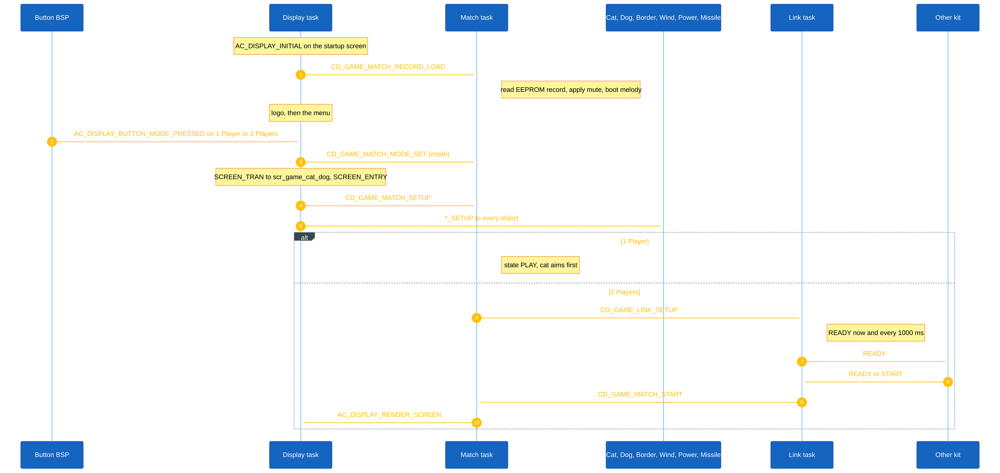
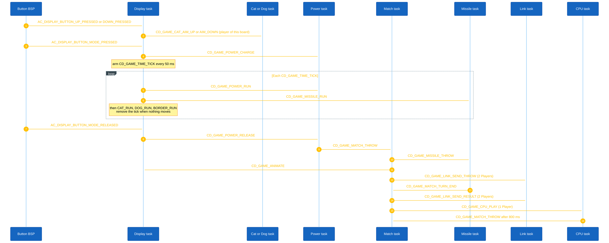
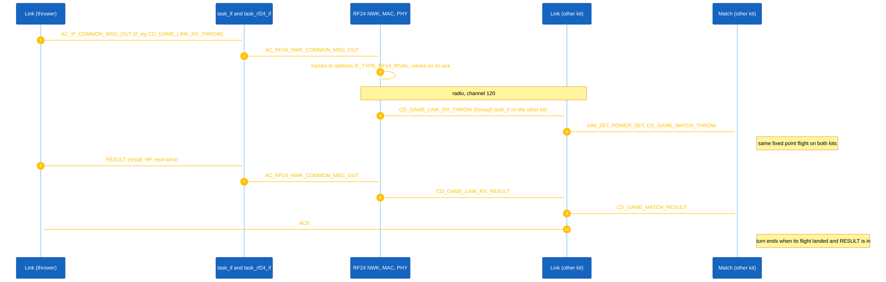
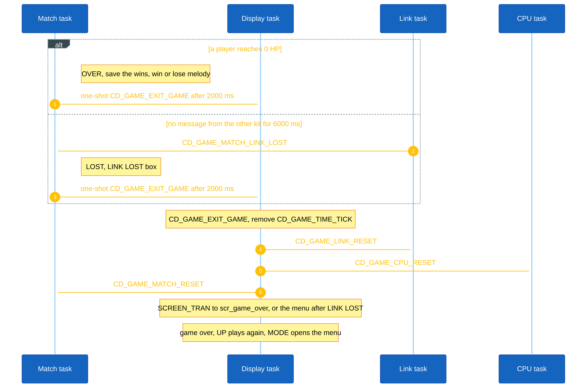

<h1 align="center">Runtime Signal Processing</h1>

This document explains how Cat vs Dog Fight processes button input, task messages, the game tick, the RF24 link, and object updates. The game uses the AK event-driven task architecture: each game object owns a task, receives signals through AK messages, and updates its own state.

## I. Overview

Cat vs Dog Fight is implemented using event-driven tasks.

Each game object owns:

- A dedicated task
- Its own signal handler
- Its own state data
- Its own update logic

The display task (`AC_TASK_DISPLAY_ID`) owns the screen manager and handles screen-level events. The game screen (`scr_game_cat_dog`) receives the game tick and the button signals, and posts signals to the objects.

Input events from hardware buttons are converted into software signals. Button callbacks always post `AC_DISPLAY_BUTTON_*` signals to `AC_TASK_DISPLAY_ID`; the active screen handler decides what to do with them.

The animation of the field is driven by a periodic timer signal on the display task, armed only while something moves:

```c
CD_GAME_TIME_TICK
```

The current tick interval is:

```c
CD_GAME_TIME_TICK_INTERVAL = 50 ms
```

The other kit (2 Players) and the computer (1 Player) take part through two more tasks: Link, with its own 1000 ms `CD_GAME_LINK_TICK`, and CPU, with a one-shot 800 ms `CD_GAME_CPU_THINK`.

Main runtime flow:

1. Button callbacks, timers, or RF24 messages create software signals.
2. Signals are posted into the AK message pool.
3. The AK scheduler dispatches messages to destination task handlers, higher priority first, in posting order within one priority.
4. Each task updates only the state it owns.
5. The screen render reads the latest object state and refreshes the display buffer. The OLED driver then sends only the rows that changed.

### High Level Architecture

#### 1. Game Start



<p align="center"><strong><em>Figure 1:</em></strong> Game start flow</p>


#### 2. Game Playing

A throw on this board, with the 50 ms tick. In 2 Players the other kit receives `THROW` and runs the same flight, then waits for `RESULT`. In 1 Player the computer plays the other side.



<p align="center"><strong><em>Figure 2:</em></strong> Game playing flow on this board</p>


Over RF24, every message goes through the interface task and the RF24 stack, and arrives on the other kit's Link task:



<p align="center"><strong><em>Figure 3:</em></strong> RF24 message path between the two kits</p>


#### 3. Game Reset



<p align="center"><strong><em>Figure 4:</em></strong> Game reset flow</p>


While waiting for the other kit, **[Mode]** runs the same reset (tick, Link, CPU and Match) and opens the menu, and so does the **[Up]+[Down]** chord at any time during a match (`cd_game_leave_to_menu()`). A missile still flying is frozen with the tick, and a late `CD_GAME_MATCH_TURN_END` is ignored because the match is no longer in `PLAY`.

## II. Code References

| Area | File |
|---|---|
| Task IDs and task handlers | `application/sources/app/task_list.h` |
| Task table registration | `application/sources/app/task_list.cpp` |
| Signal definitions | `application/sources/app/app.h` |
| Boot and button polling | `application/sources/app/app.cpp` |
| Button callback logic | `application/sources/app/app_bsp.cpp` |
| Game screens | `application/sources/app/screens/scr_game_menu.cpp`, `scr_game_cat_dog.cpp`, `scr_game_over.cpp` |
| Game objects | `application/sources/app/game/game_cat_dog/cd_game_*.cpp` |
| RF24 bridge | `application/sources/app/task_if.cpp`, `application/sources/app/task_rf24_if.cpp` |
| RF24 addresses (`BOARD=cat|dog`) | `application/sources/app/app_data.h`, `application/Makefile` |
| OLED driver (changed rows only) | `application/sources/driver/Adafruit_oled_drv/Adafruit_oled_drv.cpp` |
| EEPROM record | `application/sources/app/app_eeprom.cpp` |
| Console commands (`btn`, `stt`, `lnk`, `rf`, `pool`) | `application/sources/app/shell.cpp` |

## III. Task Ownership

| Task | Priority | Responsibility | Owns Data | Receives Signals |
|---|---|---|---|---|
| `AC_TASK_DISPLAY_ID` | 4 | Screen manager, render scheduling, button routing, game tick | Current screen, menu item | All `AC_DISPLAY_*` signals, `CD_GAME_TIME_TICK`, `CD_GAME_ANIMATE`, `CD_GAME_EXIT_GAME` |
| `CD_GAME_MATCH_ID` | 4 | Mode, state, turn, end of turn, EEPROM record | `match` | `CD_GAME_MATCH_SETUP`, `RECORD_LOAD`, `SOUND_TOGGLE`, `LEVEL_TOGGLE`, `MODE_SET`, `START`, `THROW`, `TURN_END`, `RESULT`, `LINK_LOST`, `RESET` |
| `CD_GAME_CAT_ID` / `CD_GAME_DOG_ID` | 4 | Player position, HP, angle, hit effect | `cat` / `dog` | `*_SETUP`, `*_AIM_UP`, `*_AIM_DOWN`, `*_AIM_SET`, `*_HIT`, `*_HP_SET`, `*_RUN` |
| `CD_GAME_BORDER_ID` | 4 | Wall and dust | `border` | `CD_GAME_BORDER_SETUP`, `HIT`, `RUN` |
| `CD_GAME_WIND_ID` | 4 | Wind speed | `wind` | `CD_GAME_WIND_SETUP`, `CHANGE`, `SET` |
| `CD_GAME_POWER_ID` | 4 | Power bar | `power` | `CD_GAME_POWER_SETUP`, `CHARGE`, `RUN`, `RELEASE`, `SET` |
| `CD_GAME_MISSILE_ID` | 4 | Flight and collisions | `missile` | `CD_GAME_MISSILE_SETUP`, `THROW`, `RUN` |
| `CD_GAME_LINK_ID` | 4 | RF24 messages, heartbeat, loss | `link` | `CD_GAME_LINK_SETUP`, `TICK`, `SEND_START`, `SEND_THROW`, `SEND_RESULT`, `RESET`, `RX_READY`, `RX_START`, `RX_THROW`, `RX_RESULT`, `RX_PING`, `RX_ACK` |
| `CD_GAME_CPU_ID` | 4 | Computer player | `cpu` | `CD_GAME_CPU_PLAY`, `THINK`, `RESET` |
| `AC_TASK_IF_ID`, `AC_TASK_RF24_IF_ID` | 4 | Route interface messages to and from RF24 | none | `AC_IF_*`, `AC_RF24_IF_*` |
| `AC_RF24_PHY_ID`, `AC_RF24_MAC_ID`, `AC_RF24_NWK_ID` | 3, 4, 5 | nRF24L01 stack (kit) | 3 NWK PDUs | `AC_RF24_*` |

The kernel timer task (`TASK_TIMER_TICK_ID`, priority 7) delivers every timer signal above. The console runs from a polling task that only runs when every message queue is empty.

## IV. Button Event Processing

In Cat vs Dog Fight, button callbacks always post `AC_DISPLAY_BUTTON_*` signals to `AC_TASK_DISPLAY_ID`. The currently active screen handler then decides what to do with them. The BSP does not need to know which screen is active.

The three buttons are polled every 10 ms by `sys_irq_timer_10ms()`. Each button posts on press and on release; a long press posts nothing extra.

### Button Processing Rules

| Button | BSP posts to AK | Active screen | Result inside the screen handler |
|---|---|---|---|
| MODE Pressed | `AC_DISPLAY_BUTTON_MODE_PRESSED` -> `AC_TASK_DISPLAY_ID` | Menu | Select the item: `CD_GAME_MATCH_MODE_SET` then the game, `CD_GAME_MATCH_LEVEL_TOGGLE`, `CD_GAME_MATCH_SOUND_TOGGLE`, or Exit |
| MODE Pressed | same | Game, this board aims | `CD_GAME_POWER_CHARGE` and arm the tick |
| MODE Pressed | same | Game, waiting for the other kit | Reset and back to the menu |
| MODE Released | `AC_DISPLAY_BUTTON_MODE_RELEASED` -> `AC_TASK_DISPLAY_ID` | Game | `CD_GAME_POWER_RELEASE` (ignored when not charging) |
| UP / DOWN Pressed | `AC_DISPLAY_BUTTON_UP_PRESSED` / `DOWN_PRESSED` | Menu | Previous / next item |
| UP / DOWN Pressed | same | Game, this board aims | `CD_GAME_CAT_AIM_UP` / `AIM_DOWN` (or the `DOG` signals on the dog board) |
| UP Pressed while DOWN held, or DOWN Pressed while UP held | same | Game, any state | Leave the match: same reset as giving up the wait, back to the menu |
| UP / DOWN Released | `AC_DISPLAY_BUTTON_UP_RELEASED` / `DOWN_RELEASED` | Game | Clear the held flag used by the UP+DOWN chord |
| UP Pressed | same | Game over | Play again (`SCREEN_TRAN` to the game screen) |
| MODE Pressed | `AC_DISPLAY_BUTTON_MODE_PRESSED` | Game over | Back to the menu |
| Any | Any of the above | Game, other player's turn or flight | Ignored |

The shell command `btn m|u|d [hold_ms]` posts the same press and release signals (the release after `hold_ms` through a one-shot timer), so a test driven from the console follows this exact path.

## V. Runtime Scheduling Notes

The system uses asynchronous task-based scheduling.

Important runtime characteristics:

- Signals are queued in AK before they are handled.
- A sender posts a message; it does not directly execute the destination task handler.
- Handlers run to completion (RTC): a task processes one signal fully before pulling the next.
- Every game task, the display task and the interface tasks share priority 4, so their messages run in posting order. Match relies on it: `CD_GAME_CAT_HIT` posted before `CD_GAME_MATCH_TURN_END` is applied first, and `AIM_SET`, `POWER_SET`, `MATCH_THROW` from Link arrive in that order.
- Game logic is decoupled through signals: a screen never changes an object's state directly, it posts a signal and reads the object instance when it renders. Only the owning handler writes an instance.
- The screen manager renders after every display message, at most once per `AC_DISPLAY_MINIMUM_SCREEN_RENDER_INTERVAL_MS` (50 ms). The OLED is driven by a bit-banged I2C bus; the driver keeps a checksum per 128-byte row and sends only the rows that changed (about 6 ms for two rows, 17.5 ms for a full frame).
- The game tick runs only while something moves. While waiting, aiming or idle, nothing is redrawn except on a button or `AC_DISPLAY_RENDER_SCREEN`. This leaves the CPU to the RF24 stack: a busy display delays the MAC retries, and the NWK pool holds only 3 messages in flight.
- Link sends at most one `READY` or `PING` per second, plus the throw and its result, so a kit with no answer cannot fill the NWK pool.
- A message from the other kit is trusted only after its length check, and a throw or result is applied only in the right state (`PLAY`, the other player's turn). A duplicate `RESULT` is acked again but applied once.
- Physics uses integers only (positions and speeds in 1/256 pixel, a cosine table), so both kits and the computer's prediction compute the same flight.
- A common-message payload is at most 64 bytes; every handler checks `get_data_len_common_msg()` before it casts `get_data_common_msg()`.
- The computer's plan runs about 130 simulated flights in one handler. It runs at the start of its turn, when nothing else is moving.
- EEPROM writes (about 10 bytes) happen only when a menu setting changes or a match ends.
- RAM is about 13.7 of 16 KB: about 2.7 KB of stack and a 2 KB heap. The message pools hold 48 pure, 8 common and 8 dynamic messages, with 16 timers (`ak.cfg.mk`).
